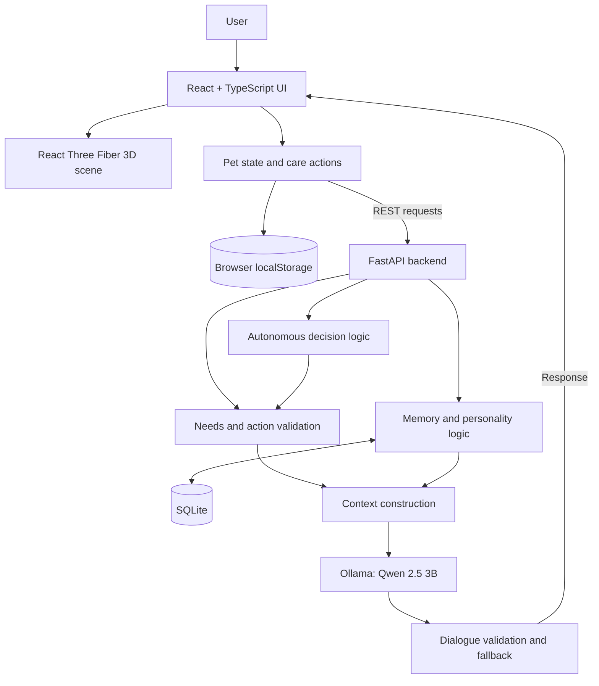
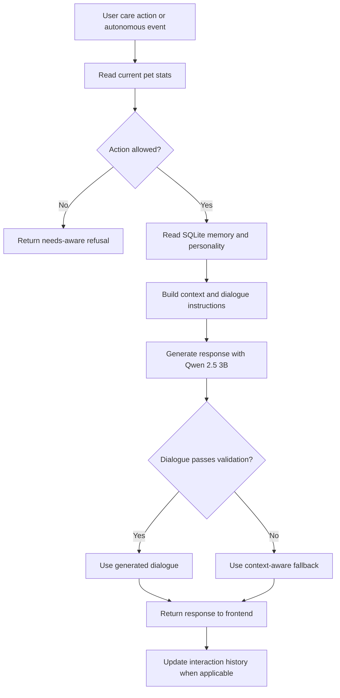

# Little AI Pet — Mochi

**A locally hosted, AI-powered virtual pet with persistent memory, adaptive personality, and autonomous behavior.**

Little AI Pet is a full-stack portfolio project exploring how a small local language model can be integrated with structured application state to create a responsive, consistent virtual companion. Mochi is an interactive 3D bunny whose dialogue and behavior respond to care actions, changing needs, and interaction history.

Rather than letting an LLM control the entire application, the system separates **deterministic pet-state logic and safety constraints** from **AI-generated dialogue**. This keeps pet behavior predictable while allowing responses to feel more personal.

> **Deployment:** Local development project. The AI backend requires Ollama running on the same computer; this repository does not currently provide a hosted demo.

## Project at a Glance

| Area | Implementation |
| --- | --- |
| Interface | React, TypeScript, Vite |
| 3D environment | Three.js, React Three Fiber, Drei |
| API | Python, FastAPI, Pydantic |
| Language model | Qwen 2.5 3B via local Ollama |
| Long-term memory | SQLite |
| Pet state | Frontend state and browser localStorage |
| Automated testing | Pytest and API/LLM evaluation scripts |

## Core Features

**Interactive pet care.** Feed, pet, play with, or put Mochi to sleep. Fullness, happiness, energy, and a derived wellness score change in response to actions and elapsed time. The system can refuse unsuitable actions, such as playing when Mochi is exhausted.

**Context-aware dialogue.** FastAPI builds dialogue context from Mochi's current statistics, emotional state, personality, and remembered interactions. A local Qwen 2.5 3B model generates short responses. Output validation and context-sensitive fallback messages help keep dialogue appropriate.

**Persistent memory.** SQLite records care interactions and autonomous events. The backend summarizes interaction history to inform later responses, including recurring care patterns and the relationship with the user.

**Adaptive personality.** A weighted window of recent interactions influences Mochi's personality profile. Personality affects both dialogue context and the selection of autonomous behavior, while physical-needs constraints remain authoritative.

**Autonomous behavior.** At intervals, Mochi can independently decide to ask for food, rest, seek attention, play, or remain idle. The backend validates proposed actions against current needs before generating dialogue.

**Interactive 3D room.** React Three Fiber renders Mochi and a cozy room with animated interactions, furniture, and an on-screen pet HUD. The large 3D assets are kept separate from the AI logic.

## System Architecture



### Responsibilities by Layer

| Component | Responsibility |
| --- | --- |
| React frontend | Display pet statistics, manage interactions, render the 3D scene, and persist local pet state |
| FastAPI backend | Validate actions, construct AI context, manage memory and personality, and return dialogue/decisions |
| SQLite | Persist interaction and autonomous-event history |
| Ollama / Qwen 2.5 3B | Generate short natural-language dialogue from backend-provided context |

The **pet's numeric state** is managed in the frontend and persisted in browser localStorage; **interaction history and learned personality inputs** are stored in the backend's SQLite database. These are distinct persistence mechanisms.

## How Mochi Responds



For autonomous events, the backend selects and validates a behavior using the current pet needs and personality profile; the language model supplies the wording, not the final authority over the action.

## Engineering Decisions

### Why a Local Language Model?

Qwen 2.5 3B runs through Ollama without requiring a paid external inference API. This makes the project reproducible locally and gives direct control over prompt construction and response handling. The trade-off is that anyone running the project must install Ollama and download the model.

### Why Separate Rules from Generation?

Pet-care constraints should not depend on probabilistic text generation. For example, the backend can reject play when Mochi lacks energy, regardless of what the model might otherwise say. Validation and fallback dialogue provide another layer of consistency.

### How Does Personality Change?

The backend derives personality signals from weighted recent care history rather than relying on the model to invent or independently remember personality changes. Structured memory and personality information are passed into dialogue generation as context.

### How Is Memory Stored?

SQLite stores backend interaction records, while the browser stores the current pet state. The application can therefore maintain a care history across sessions without requiring a cloud database.

## Testing and Evaluation

Local tests were run against Mochi AI 2.6 with `qwen2.5:3b`.

| Evaluation | Observed result |
| --- | --- |
| Automated unit tests | **26 / 26 passed** |
| API scenario smoke tests | **10 / 10 completed** |
| LLM evaluation scenarios | **12 / 12 completed** |
| Valid final dialogue in LLM evaluation | **12 / 12** |
| Mean latency in the 12-scenario LLM evaluation | **1.41 seconds** |

The tests cover needs-aware dialogue, action refusals, memory persistence, personality calculations, autonomous decisions, dialogue formatting, and repetition checks. These are **local functional and rule-based evaluations**, not a claim of comprehensive semantic accuracy or production performance.

To rerun the automated unit tests:

```bash
python3 -m pytest backend/tests/test_mochi_ai.py -v
```

An API smoke-test script is also available:

```bash
python3 backend/evaluate_ai.py
```

**Note:** The API smoke test writes interactions to the local SQLite memory. The separate LLM quality evaluation was run read-only.

## Run Locally

### Prerequisites

- Node.js and npm
- Python 3
- [Ollama](https://ollama.com/)

### 1. Clone the Repository

```bash
git clone https://github.com/tingxi01/little-ai-pet.git
cd little-ai-pet
```

### 2. Install Frontend Dependencies

```bash
npm install
```

### 3. Install Backend Dependencies

```bash
python3 -m pip install fastapi 'uvicorn[standard]' pytest
```

### 4. Download the Local Language Model

```bash
ollama pull qwen2.5:3b
```

Ensure the Ollama service is running. If it is not already running, start it in a separate terminal:

```bash
ollama serve
```

### 5. Start the Backend

From the project root, open another terminal:

```bash
python3 -m uvicorn backend.main:app --reload --port 8000
```

Verify the API at [http://127.0.0.1:8000/health](http://127.0.0.1:8000/health).

### 6. Start the Frontend

In another terminal, from the project root:

```bash
npm run dev -- --port 5180
```

Open **http://localhost:5180**.

> The frontend currently calls `http://127.0.0.1:8000` directly. Both services are intended to run on the same machine. The application also needs its 3D model and texture files under `public/` to render the complete scene.

## Repository Structure

```text
little-ai-pet/
├── backend/
│   ├── main.py                 # FastAPI, dialogue, memory, personality, autonomy
│   ├── evaluate_ai.py          # API scenario evaluation
│   └── tests/                  # Automated backend tests
├── public/                     # 3D models and static assets
├── src/
│   ├── components/             # 3D scene, Mochi, HUD, room elements
│   ├── hooks/                  # Pet state and backend integration
│   ├── lib/                    # Pet-care rules and state calculations
│   └── App.tsx                 # Main application
├── package.json
└── README.md
```

## Current Scope

This is a **local portfolio application**, not a deployed service. The current implementation focuses on a single virtual pet, local AI inference, persistent interaction history, and an interactive 3D experience. Multi-user accounts, cloud synchronization, and production deployment are outside its present scope.

## Author

**Ng Ting Xi**  
Computer Science graduate — Data Science and Artificial Intelligence  
[GitHub](https://github.com/tingxi01)
